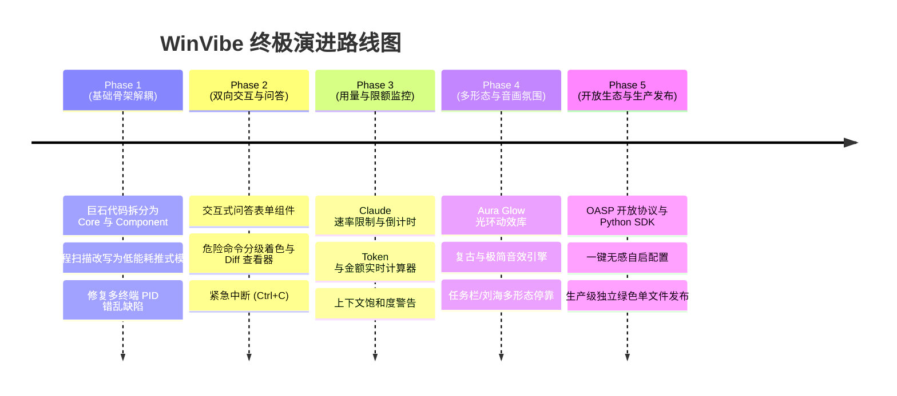

# WinVibe Agent Hub 终极重构与升级方案 (类比 macOS Vibe Island)

> **定位**：将当前初具雏形的 Windows 灵动岛工具，重构成 Windows 生态下**工业级、对标乃至超越 macOS Vibe Island 的顶级 AI Agent 指挥中心（Next-Gen AI Agent Command Deck）**。

---

## 一、整体对标与全景差距分析 (WinVibe vs. Vibe Island)

| 核心维度 | macOS Vibe Island (行业标杆) | 当前 WinVibe (现状) | 终极目标 (Master 级改造后) |
| :--- | :--- | :--- | :--- |
| **形态与原生感** | 完美贴合 MacBook 硬件刘海，物理弹簧动力学，无缝融入 macOS | 屏幕顶栏透明悬浮胶囊，已攻克穿透与毛玻璃 | **多形态锚定**：刘海岛态、Win11 任务栏伴侣态、桌面磁吸任意浮窗三合一 |
| **Agent 适配生态** | 深度支持 30+ 种主流 CLI/Agent (Claude Code, Codex, Cursor, Gemini 等) | 硬编码适配 4 种 (Claude, Antigravity, OpenCode, Hermes) | **统一适配器架构 (Adapter Matrix)** + **OASP 开放协议**，即插即用无限扩展 |
| **双向交互能力** | 仅限点击审批，极简问答 | 仅限 Alt+Y/Alt+N 批准/拒绝 Bash 命令 | **完整双向交互闭环**：单选/多选题答复、自由文本指令追问、Diff 对比预览、紧急熔断 (Ctrl+C) |
| **能耗与进程感知** | 原生 Swift/C++ 架构，Unix Socket 事件驱动，零空闲 CPU | 5 秒一次 `tasklist /fo csv` 轮询，开销较高且有微卡顿 | **推式心跳 (Push-First) + Win32 进程生命周期监听**，空闲 CPU 占用趋近 0% |
| **算力与用量监控** | 实时追踪 Claude 5小时/7天速率限制、Token 消耗与花费 ($) | 仅记录本地 Bash 审计日志，无 Token 与成本概念 | **全维度用量雷达**：Claude/GPT 速率限制预警、当前会话费用估算、上下文窗口饱和度仪表 |
| **多终端并发调度** | 会话自动聚合与标签切换，清晰归属 | 已有基础 SessionRegistry，但单例与 PID 匹配仍有隐患 | **Swarm 会话树引擎**：精准关联 Terminal Tab/VSCode 窗口，支持多 Agent 协同流水线视图 |
| **视听与微交互体验** | 标志性 8-bit 复古机械音效、精致光效、触觉反馈 | 简易 Web Audio 蜂鸣音、基础 Framer Motion 动效 | **光环呼吸流光 (Aura Glow)** + **高保真微交互音效包** (机械键轴/科幻/极简静音可切换) |
| **代码工程质量** | 模块化工业级 Swift/Native 架构 | 1200+ 行 `main.ts` 与 1100+ 行 `App.tsx` 巨石代码 | **DDD 领域驱动拆分**：Core Daemon, Adapter Layer, UI Design System, Telemetry |

---

## 二、核心架构重构设计 (Architecture Blueprint)

```mermaid
flowchart TD
    subgraph UI ["前端渲染层 (React 19 + Tailwind + Framer Motion)"]
        Island["动态胶囊 (Island Pill)"]
        ExpandedDeck["展开式中控台 (Command Deck)"]
        QuestionCard["交互问答/审批抽屉 (Decision Drawer)"]
        TelemetryBar["用量与配额雷达 (Telemetry & Rate Limit)"]
        AuditTab["安全审计与回溯 (Audit & History)"]
    end

    subgraph Core ["主进程核心层 (Electron Modular Core)"]
        WindowManager["窗口与穿透管理器 (WindowManager)"]
        SessionHub["会话与事件中枢 (SessionHub)"]
        DecisionEngine["决策与仲裁引擎 (DecisionEngine)"]
        Win32Bridge["Win32 原生调用助手 (WinVibeHelper)"]
        TelemetryService["用量统计与限流感知 (TelemetryService)"]
    end

    subgraph Adapters ["通用 Agent 适配矩阵 (Adapter Matrix)"]
        ClaudeAdapter["Claude Code 适配器 (Hooks 闭环)"]
        AgyAdapter["Antigravity 适配器 (Transcript/IPC)"]
        CursorAdapter["Cursor / Windsurf 适配器"]
        OpenCodeAdapter["OpenCode / Hermes 适配器"]
        GenericOASP["开放 Agent 状态协议 (OASP HTTP/WS)"]
    end

    subgraph Agents ["底层终端与 AI Agents"]
        Agent1["Claude Code (Terminal)"]
        Agent2["Google Antigravity"]
        Agent3["Cursor Background Agent"]
        Agent4["Custom Agent / Script"]
    end

    Agents -->|Hooks / Log / IPC / HTTP| Adapters
    Adapters -->|标准化统一事件 (Unified AgentEvent)| SessionHub
    SessionHub <--> DecisionEngine
    SessionHub --> WindowManager
    SessionHub --> TelemetryService
    DecisionEngine -->|IPC| QuestionCard
    WindowManager -->|IPC| Island
    DecisionEngine -->|HTTP/Key Injection| Win32Bridge
    Win32Bridge -->|精确窗口唤醒与输入| Agents
```

---

## 三、六大重构模块与演进路线 (Detailed Plan)

### 模块一：巨石代码解耦与模块化重构 (Code Refactoring)
* **痛点**：当前 `electron/main.ts` 超过 1200 行，将 HTTP 路由、进程轮询、日志解析、Win32 调度混杂在一起；`src/App.tsx` 超过 1100 行，承担所有视图与逻辑。
* **重构方案**：
  * **主进程核心拆分 (`electron/`)**：
    - `core/WindowManager.ts`：负责半透明无边框窗口、多显示器位置校准、动态点击穿透管理 (`setIgnoreMouseEvents`)。
    - `core/HttpDaemon.ts`：独立安全 REST/WebSocket 服务，负责鉴权、审批长轮询与心跳维护。
    - `core/SessionHub.ts`：以 `sessionId` 为唯一主键的会话状态机，彻底杜绝多终端单例串台。
    - `adapters/`：每个 Agent 单独实现 `AgentAdapter` 接口（`ClaudeAdapter.ts`, `AntigravityAdapter.ts`, `CursorAdapter.ts` 等）。
    - `services/TelemetryService.ts`：负责 Token 计算、模型消耗账单统计与限额嗅探。
  * **前端组件化拆分 (`src/`)**：
    - `components/island/IslandPill.tsx`：收缩态轻量胶囊与实时微状态。
    - `components/deck/CommandDeck.tsx`：展开态全景面板，多终端会话卡片切换。
    - `components/decision/DecisionDrawer.tsx`：审批与问答抽屉，支持命令着色与选项答复。
    - `components/telemetry/RateLimitRadar.tsx`：5小时限额环形图与花费展示。
    - `store/agentStore.ts`：基于 Zustand 的高性能局部状态管理，避免全局频繁重渲染。

---

### 模块二：通用 Agent 适配器矩阵 (Adapter Matrix) 与开放协议 (OASP)
* **标准适配接口设计**：
  ```typescript
  export interface AgentAdapter {
    readonly id: string;
    readonly displayName: string;
    readonly icon: string;
    init(): Promise<void>;
    destroy(): Promise<void>;
    handleDecision?(requestId: string, action: DecisionAction, input?: string): Promise<void>;
  }
  ```
* **主流 Agent 全方位升级**：
  1. **Claude Code 2.0**：
     - 全面接入官方 Hooks：`PreToolUse` (审批拦截)、`UserPromptSubmit` (推理思考感知)、`Stop` (任务完成)、`Notification` (系统提醒)。
     - 实时解析 `~/.claude/cost.json` 或标准输出中的 token 统计信息。
  2. **Google Antigravity 2.0**：
     - 深度解析 `transcript.jsonl`，抽取 `ask_question` 工具调用，直接在灵动岛上提供单选/多选题交互；
     - 识别 `invoke_subagent` 树状派生结构，展示子 Agent 并发工作流。
  3. **Cursor & Windsurf**：
     - 监听本地运行进程与端口，实时呈现代码生成任务进度。
  4. **开放 OASP (Open Agent Status Protocol)**：
     - 开放 `POST /api/v1/agent/pulse` 与 WebSocket 通道，提供 Python / Node 轻量 SDK。任何自定义 Agent 仅需调用一次 SDK 即可入驻灵动岛。

---

### 模块三：从“粗暴放行”到“深度双向控制” (Deep Interactive Control)
* **不仅是 Allow / Deny，支持直接答复**：
  - 当 Agent 抛出方案选择题（如：`1. 方案A  2. 方案B`），灵动岛直接生成按钮，点击直接注入回答；
  - 提供 Mini 快速输入框，用户可在灵动岛直接输入补充 Prompt，按 `Enter` 提交，彻底告别来回切换终端窗口。
* **命令危险级别智能评估 (Risk Assessment Engine)**：
  - **安全 (绿色 Safe)**：只读查询类（`git status`, `ls`, `cat`, `cargo check` 等）；
  - **警告 (黄色 Warning)**：安装依赖、普通写操作（`npm install`, `pip install`, `touch test.ts`）；
  - **危险 (红色 Danger/Critical)**：破坏性操作（`rm -rf`, `git push --force`, `drop database`, 覆写关键配置），高亮闪烁警示并强制延迟 1 秒确认。
* **全局紧急熔断与指令干预**：
  - 灵动岛集成一键中断（向目标终端发送 `Ctrl+C` 信号）；
  - 快捷指令预设（“重新生成”、“停止重试”、“简述要点”）。

---

### 模块四：算力、Token、花费与速率限制雷达 (Telemetry & Quota Radar)
* **对标 Vibe Island 最核心的硬核能力**：
  - **Claude 5小时/7天速率限制追踪 (Rolling Rate Limit Tracker)**：
    - 精确显示当前 5 小时滚动窗口的使用率与预估刷新时间（如：“5小时额度已用 72%，预计 15:40 重置”）。
  - **实时会话花费 ($ USD) 统计**：
    - 针对 Claude 3.7 Sonnet / Opus / Gemini 2.5 Pro 等模型，按输入/输出/缓存 Token 实时计算美元花销。
  - **上下文饱和度仪表 (Context Saturation Meter)**：
    - 直观呈现当前上下文长度占最大上限（如 200k）的比例，超过 70% 时自动提醒建议使用 `/compact` 压缩上下文。

---

### 模块五：Windows 原生深度体验与极致性能 (Native Ergonomics & Performance)
* **低功耗推式心跳架构 (Zero-Polling Daemon)**：
  - 彻底淘汰当前每 5 秒运行一次 `tasklist /fo csv` 的高开销轮询设计；
  - 采用基于 Hook 请求的主动注册心跳（Push-First），配合 Win32 事件，待机空闲 CPU 占用趋近于 0%。
* **精准到 Tab 的窗口直达 (Jump-Back 2.0)**：
  - 深度适配 Windows Terminal (`wt.exe`)、VS Code 内置终端、Cursor、WezTerm 等；
  - 点击卡片直接穿透前台锁定，一键跳转到发出请求的精确标签页。
* **多形态停靠支持 (Multi-Form Factor)**：
  - 模式 1：屏幕顶栏灵动岛（标准 Dynamic Island）；
  - 模式 2：Windows 11 任务栏伴侣（吸附在系统托盘旁）；
  - 模式 3：迷你浮动球（可任意拖拽并吸附屏幕边缘）。

---

### 模块六：顶级视听动效与“Vibe”氛围 (Sensory & Micro-Interactions)
* **动态光环呼吸系统 (Aura Glow)**：
  - **Cyan/Blue 粒子流动**：Agent 正在高速流式推理；
  - **Golden 呼吸流光**：正在等待用户审批决策；
  - **Emerald Green 成功脉冲**：任务圆满交付；
  - **Crimson 警示**：发生编译报错或异常中断。
* **高保真微交互音效包**：
  - 标志性复古 8-bit 芯片音乐（致敬 Vibe Island 经典）；
  - 极简机械轴微动触感音效；
  - 独立静音快捷键 (`Alt+M`) 与各状态音效开关。

---

## 四、实施里程碑 (Implementation Milestones)



---

## 五、验证计划 (Verification Plan)

### 1. 自动化单元与集成测试
* **协议与会话隔离测试**：
  ```powershell
  npm test
  # 验证 SessionRegistry 在多会话并发、乱序到达、超时场景下的准确性
  ```
* **架构解耦编译校验**：
  ```powershell
  npm run build
  # 验证 TypeScript 零类型错误与 Vite/Electron 打包成功
  ```

### 2. 人工端到端体验验证
* **多终端并发审批**：同时开启 2 个 Claude Code 终端，分别触发 `Bash` 审批，验证灵动岛队列与快捷键无串台精准处理。
* **双向答复测试**：在 Antigravity 中触发提问，验证灵动岛上直接点击选项答复，终端即时继续。
* **速率限制与用量**：触发长会话，查看灵动岛限额百分比与 Token 花费数据实时跳动。


---

## 六、重构实施进度与交付记录 (Execution Log)

### ✅ Phase 1: 核心巨石架构解耦与低功耗引擎 (已完成)
- [x] 将 1200+ 行 `electron/main.ts` 拆解为 `core/`、`adapters/` 与 `services/` 模块化架构。
- [x] 构建 [`electron/core/SessionHub.ts`](file:///D:/vibe/agent/electron/core/SessionHub.ts) 统一会话与决策队列中枢，根治多终端串台与 PID 错乱。
- [x] 淘汰 5 秒 `tasklist` 频繁轮询，重构为 [`electron/core/ProcessWatcher.ts`](file:///D:/vibe/agent/electron/core/ProcessWatcher.ts) 低开销推式感知机制。
- [x] 统一 Agent 适配协议，拆分 [`AntigravityAdapter.ts`](file:///D:/vibe/agent/electron/adapters/AntigravityAdapter.ts)、[`OpenCodeAdapter.ts`](file:///D:/vibe/agent/electron/adapters/OpenCodeAdapter.ts) 与 [`HermesAdapter.ts`](file:///D:/vibe/agent/electron/adapters/HermesAdapter.ts)。
- [x] 编写并跑通全量单元测试 (`npm test`: 6/6 通过)。

### ✅ Phase 2: 深度双向控制与微交互体验 (已完成)
- [x] 消除 1100+ 行 `src/App.tsx` 视图代码，拆解为 `components/island`、`components/decision`、`components/deck`、`components/telemetry`、`components/audit`。
- [x] 实现抽屉式交互控制台 [`DecisionDrawer.tsx`](file:///D:/vibe/agent/src/components/decision/DecisionDrawer.tsx)：
  - 支持直接点击选择题选项答复；
  - 支持键盘数字键 `[1]`, `[2]`, `[3]` 极速快捷答题；
  - 支持 Mini 文本输入框补充指令；
  - 危险 Bash 命令一键复制并带风险等级指示。
- [x] 实现自动化命令风险等级评估引擎 [`utils/risk.ts`](file:///D:/vibe/agent/src/utils/risk.ts)（绿色只读、黄色写入、红色高危破坏性操作）。
- [x] 实现 Claude 5小时滚动限制雷达与用量仪表盘 [`RateLimitRadar.tsx`](file:///D:/vibe/agent/src/components/telemetry/RateLimitRadar.tsx)。
- [x] 实现状态动态光环呼吸流光 [`AuraGlow.tsx`](file:///D:/vibe/agent/src/components/island/AuraGlow.tsx) 与 8-bit / 机械微动音效 [`audio.ts`](file:///D:/vibe/agent/src/utils/audio.ts)。
- [x] 实现紧急失控进程中断熔断 (Ctrl+C / Kill)。


### ✅ Phase 3: 生态开放与通用协议适配 (已完成)
- [x] 实现开放 Agent 状态协议 (**OASP** - Open Agent Status Protocol) 核心支持。
- [x] 提供零依赖 Python SDK [`scripts/winvibe_sdk.py`](file:///D:/vibe/agent/scripts/winvibe_sdk.py)：
  - 支持 `pulse(status, message, cwd, metrics)`；
  - 支持 `request_approval(command, tool_name)` 阻塞审批；
  - 支持 `ask_question(question, options)` 单选/多选交互；
  - 自动发现 `%USERPROFILE%/.winvibe/daemon.json` 实现零配置直连。
- [x] 提供零依赖 Node.js SDK [`scripts/winvibe_sdk.js`](file:///D:/vibe/agent/scripts/winvibe_sdk.js)。
- [x] 新增 Cursor Composer 适配器 [`electron/adapters/CursorAdapter.ts`](file:///D:/vibe/agent/electron/adapters/CursorAdapter.ts)。
- [x] 提供全平台统一环境诊断与 Hook 安装命令 [`scripts/setup-agent-hooks.js`](file:///D:/vibe/agent/scripts/setup-agent-hooks.js)。
- [x] 编写并跑通端到端自动化测试 (`npm test`: 7/7 通过)。
