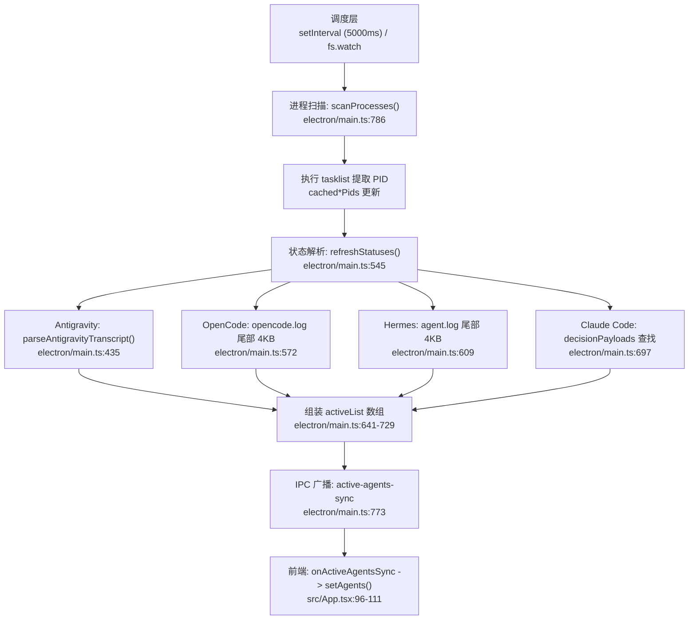
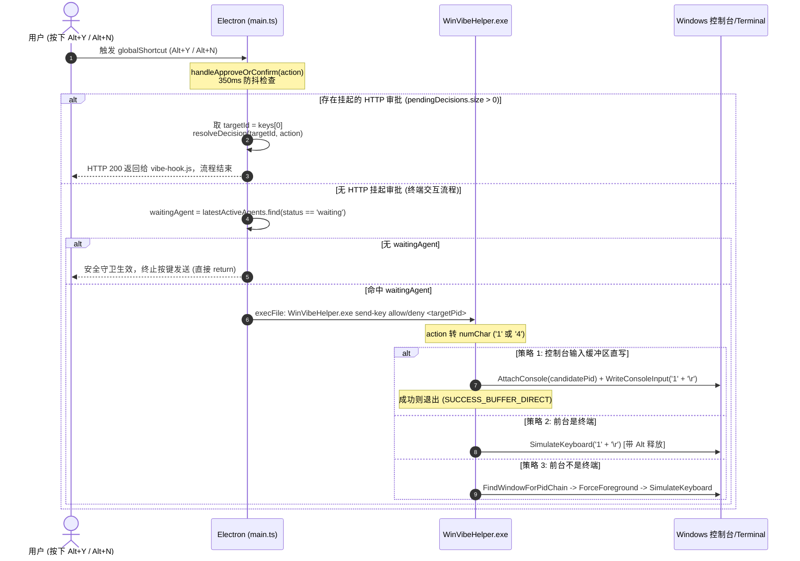

# WinVibe Agent 状态流与按键注入机制审计报告 (AUDIT.md)

> 本文档针对 `D:\vibe\agent` 代码库进行只读代码审计，覆盖 `electron/main.ts`、`scripts/WinVibeHelper.cs`、`scripts/install-claude-hook.js` 与 `scripts/vibe-hook.js`。
> 审计重点关注：多 Agent 状态数据流、多实例状态共享缺陷、PID 选取缺陷、HTTP 守护接口规范、快捷键注入链路及改造风险点。

---

## 1. 现有状态数据流链路分析

完整状态数据链路为：**定时/事件驱动调度 → 进程扫描 (`tasklist`) → 各 Agent 日志与上下文解析 → `activeList` 组装与去重 → IPC 广播至渲染层 (前端 React)**。



### 1.1 触发与调度入口
* **主进程启动入口**：
  * [`electron/main.ts:1058`](file:///D:/vibe/agent/electron/main.ts#L1058)：`app.whenReady()` 阶段调用 `startAgentWatcher()`。
* **周期保底与事件监听**：
  * [`electron/main.ts:854`](file:///D:/vibe/agent/electron/main.ts#L854)：启动时执行首轮 `scanProcesses()`。
  * [`electron/main.ts:857-859`](file:///D:/vibe/agent/electron/main.ts#L857-L859)：`setInterval(() => scanProcesses(), 5000)` 每 5 秒轮询保底。
  * [`electron/main.ts:826-851`](file:///D:/vibe/agent/electron/main.ts#L826-L851)：使用 `fs.watch` 监听 Antigravity `brainDir`、OpenCode 日志目录、Hermes 日志目录，发生变动时触发 `triggerFastRefresh()`（防抖 60ms 触发 `refreshStatuses()`，见 [`electron/main.ts:778-783`](file:///D:/vibe/agent/electron/main.ts#L778-L783)）。

### 1.2 进程扫描 (`scanProcesses`)
* **函数位置**：[`electron/main.ts:786-823`](file:///D:/vibe/agent/electron/main.ts#L786-L823)
* **执行命令**：[`electron/main.ts:790`](file:///D:/vibe/agent/electron/main.ts#L790) 调用 `execFile('tasklist', ['/fo', 'csv', '/nh'], ...)`。
* **正则匹配各 Agent PID**：
  * **Google Antigravity**：[`electron/main.ts:801-803`](file:///D:/vibe/agent/electron/main.ts#L801-L803) 匹配 `/^"(agy|Antigravity)\.exe"/i`。
  * **OpenCode**：[`electron/main.ts:804-806`](file:///D:/vibe/agent/electron/main.ts#L804-L806) 匹配 `/^"opencode\.exe"/i`。
  * **Claude Code**：[`electron/main.ts:807-809`](file:///D:/vibe/agent/electron/main.ts#L807-L809) 匹配 `/^"(claude|claude-code)\.exe"/i`。
  * **Hermes Agent**：[`electron/main.ts:810-812`](file:///D:/vibe/agent/electron/main.ts#L810-L812) 匹配 `/^"(hermes|hermes-agent|hermes-acp)\.exe"/i`。
* **更新缓存并调用状态刷新**：[`electron/main.ts:816-821`](file:///D:/vibe/agent/electron/main.ts#L816-L821) 更新 `cached*Pids` 集合后立即调用 `refreshStatuses()`。

### 1.3 日志与上下文解析 (`refreshStatuses`)
* **函数位置**：[`electron/main.ts:545-775`](file:///D:/vibe/agent/electron/main.ts#L545-L775)
* **Antigravity 会话检索与解析**：
  * [`electron/main.ts:548-565`](file:///D:/vibe/agent/electron/main.ts#L548-L565)：扫描 `~/.gemini/antigravity-cli/brain` 目录下的所有 `transcript.jsonl`，按修改时间倒序排列获取 `sessions` 列表。
  * [`electron/main.ts:435-527`](file:///D:/vibe/agent/electron/main.ts#L435-L527)：`parseAntigravityTranscript(logFile, sessionId, pid)`：
    * 逐行读取末尾记录：若 `last.type === 'USER_INPUT'` 为 `running`（[`L445-L447`](file:///D:/vibe/agent/electron/main.ts#L445-L447)）。
    * 若末尾为 `ask_question` 工具调用，标记为 `waiting` 并抽取题目选项生成 `questionPayload`（[`L452-L474`](file:///D:/vibe/agent/electron/main.ts#L452-L474)）。
    * 若末尾为 `run_command` 工具调用，标记为 `waiting`，生成审批请求载荷（[`L475-L495`](file:///D:/vibe/agent/electron/main.ts#L475-L495)）。
    * 若为文本问答（以 `?`/`？` 结尾或含编号选项），标记为 `waiting`（[`L500-519`](file:///D:/vibe/agent/electron/main.ts#L500-L519)）；其余标记为 `completed`（[`L497-L499`](file:///D:/vibe/agent/electron/main.ts#L497-L499)）。
* **OpenCode 状态解析**：
  * [`electron/main.ts:567-602`](file:///D:/vibe/agent/electron/main.ts#L567-L602)：读取 `~/.local/share/opencode/log/opencode.log` 尾部 4096 字节。匹配 `stream` 关键字标记为 `running`，`AI_APICallError` 标记为 `error`，其余在 25s 内修改标记为 `completed`。
* **Hermes 状态解析**：
  * [`electron/main.ts:604-639`](file:///D:/vibe/agent/electron/main.ts#L604-L639)：读取 `%LOCALAPPDATA%\hermes\logs\agent.log` 尾部 4096 字节。匹配 `Streaming` / `tool_call` 标记为 `running`，匹配 API 报错标记为 `error`，其余标记为 `completed`。

### 1.4 activeList 组装与挂载
* **实例组装**：[`electron/main.ts:641-729`](file:///D:/vibe/agent/electron/main.ts#L641-L729)
  * Antigravity 挂载：[`electron/main.ts:649-675`](file:///D:/vibe/agent/electron/main.ts#L649-L675) 为每个 PID 挂载 `id: 'agy-<pid>'`。
  * OpenCode 挂载：[`electron/main.ts:678-689`](file:///D:/vibe/agent/electron/main.ts#L678-L689) 为每个 PID 挂载 `id: 'opencode-<pid>'`。
  * Claude Code 挂载：[`electron/main.ts:692-714`](file:///D:/vibe/agent/electron/main.ts#L692-L714) 检查 `decisionPayloads` 是否有挂起审批并赋值状态。
  * Hermes 挂载：[`electron/main.ts:717-728`](file:///D:/vibe/agent/electron/main.ts#L717-L728) 为每个 PID 挂载 `id: 'hermes-<pid>'`。
* **原生系统通知触发**：[`electron/main.ts:730-751`](file:///D:/vibe/agent/electron/main.ts#L730-L751)，当状态由 `running` 转变为 `completed` 时弹出 Windows Toast。

### 1.5 同步至前端 (IPC 广播)
* **主进程发送**：
  * 提问与审批卡片推送：[`electron/main.ts:756-762`](file:///D:/vibe/agent/electron/main.ts#L756-L762) 调用 `mainWindow.webContents.send('decision-request', qPayload)`。
  * 消除卡片广播：[`electron/main.ts:768`](file:///D:/vibe/agent/electron/main.ts#L768) 调用 `mainWindow.webContents.send('decision-resolved', { requestId: 'agy-all', action: 'dismiss' })`。
  * 全量列表推送：[`electron/main.ts:773`](file:///D:/vibe/agent/electron/main.ts#L773) 调用 `mainWindow.webContents.send('active-agents-sync', activeList)`。
* **前端接收处理**：
  * [`src/App.tsx:96-111`](file:///D:/vibe/agent/src/App.tsx#L96-L111)：监听 `onActiveAgentsSync`，调用 `setAgents(syncedAgents)` 驱动灵动岛胶囊状态与面板列表重绘。

---

## 2. 所有"按 Agent 类型共享状态"的位置

当前架构存在“针对 Agent 类型解析全局单例状态，然后广播给该类型全部进程”的设计硬伤，导致多终端并发时状态互相污染：

| 序号 | 文件及行号 | 共享状态字段 | 共享/覆盖逻辑 | 导致的问题 |
| :--- | :--- | :--- | :--- | :--- |
| **1** | [`electron/main.ts:568-601`](file:///D:/vibe/agent/electron/main.ts#L568-L601)<br>与 [`L678-689`](file:///D:/vibe/agent/electron/main.ts#L678-L689) | `opencodeStatus`<br>`opencodeMessage` | 在 `refreshStatuses()` 作用域内只读单份 `opencode.log` 得到单组状态，随后在 `opencodeArray.forEach` 中把这组状态**直接赋值给所有的 OpenCode 实例**。 | 若用户启动了 2 个 OpenCode，终端 A 正在推理，终端 B 处于空闲，终端 B 会被强制显示为“正在流式生成”。 |
| **2** | [`electron/main.ts:605-638`](file:///D:/vibe/agent/electron/main.ts#L605-L638)<br>与 [`L717-728`](file:///D:/vibe/agent/electron/main.ts#L717-L728) | `hermesStatus`<br>`hermesMessage` | 在 `refreshStatuses()` 作用域内只读单份 `agent.log` 得到单组状态，随后在 `hermesArray.forEach` 中**直接赋值给所有的 Hermes 实例**。 | 多个 Hermes 终端无法独立呈现状态，只要其中一个报错，全部显示报错。 |
| **3** | [`electron/main.ts:654`](file:///D:/vibe/agent/electron/main.ts#L654) | `session`<br>(Antigravity) | `const session = sessions[idx] \|\| sessions[0];`<br>当活跃的 Antigravity 进程数超过检索到的 sessions 数量时，**超出部分全量回退并共享 `sessions[0]`**。 | 多个终端打开 Antigravity 时，未匹配到的终端会直接复用第 1 个终端的会话内容和提问状态。 |
| **4** | [`electron/main.ts:765-770`](file:///D:/vibe/agent/electron/main.ts#L765-L770) | `decision-resolved` (`agy-all`) | `const hasAnyAgyWaiting = activeList.some(...)`<br>只要所有 Antigravity 实例中**没有任何一个**处于 `waiting`，就会全局发送 `requestId: 'agy-all'`。 | 前端 [`src/App.tsx:121-123`](file:///D:/vibe/agent/src/App.tsx#L121-L123) 收到后会把**所有** `agy-` 开头的决策卡片全部清空，缺乏按 session/PID 维度的精准生命周期管理。 |

---

## 3. 所有使用 `.find()` / `[0]` 选择目标 PID 的位置

以下代码点在多终端场景下只取首项，导致操作被死锁在第一个终端或随机错误分发：

### 3.1 核心业务决策与按键分发（高危）
* **1. 快捷键优先消费首个 HTTP 挂起审批**：
  * **代码位置**：[`electron/main.ts:894-896`](file:///D:/vibe/agent/electron/main.ts#L894-L896)
  * **代码片段**：
    ```typescript
    const keys = Array.from(pendingDecisions.keys());
    if (keys.length > 0) {
      const targetId = keys[0]; // [0] 永远只取 Map 中的第一个 key
      resolveDecision(targetId, action);
    ```
  * **影响**：多个 Agent 同时上报 HTTP 审批请求时，快捷键始终只处理第一个，无法由用户指定选择。
* **2. 快捷键选择终端 Waiting 实例**：
  * **代码位置**：[`electron/main.ts:911-925`](file:///D:/vibe/agent/electron/main.ts#L911-L925)
  * **代码片段**：
    ```typescript
    const waitingAgent = latestActiveAgents.find(a => a.status === 'waiting');
    const targetPid = waitingAgent.pid || 0;
    ```
  * **影响**：`.find()` 仅返回首个匹配项。若终端 A、终端 B 都在提问，按快捷键**按键永远只打到终端 A**，终端 B 永远无法通过快捷键确认。
* **3. Claude Code 审批匹配回退**：
  * **代码位置**：[`electron/main.ts:697-699`](file:///D:/vibe/agent/electron/main.ts#L697-L699)
  * **代码片段**：
    ```typescript
    const pendingForThis = Array.from(decisionPayloads.values()).find(
      d => d.agent_name === 'Claude Code' && (d.pid === pid || !d.pid)
    );
    ```
  * **影响**：若上报 payload 中缺失 `pid`，`.find()` 会直接把审批项错配给遍历到的第 1 个 Claude 实例。
* **4. Antigravity 实例与会话下标回退**：
  * **代码位置**：[`electron/main.ts:654`](file:///D:/vibe/agent/electron/main.ts#L654)
  * **代码片段**：
    ```typescript
    const session = sessions[idx] || sessions[0]; // [0] 强行回退到最新 session
    ```
  * **影响**：多终端并发时进程顺序与 session 顺序不对应，导致 PID 绑定到了错误的日志会话。

### 3.2 注入底层与 UI 前端（中危）
* **5. 前端当前展示卡片**：
  * **代码位置**：[`src/App.tsx:39`](file:///D:/vibe/agent/src/App.tsx#L39)
  * **代码片段**：`const currentDecision = decisionQueue[0] || null;`
  * **影响**：UI 顶部灵动岛仅能单卡片排队展示，多终端等待提问时无法直观感知并联切换。
* **6. 前端快捷键事件消费**：
  * **代码位置**：[`src/App.tsx:142-148`](file:///D:/vibe/agent/src/App.tsx#L142-L148)
  * **代码片段**：`const target = prev[0]; ... return prev.slice(1);`
  * **影响**：只消费队列中第 1 个元素。
* **7. Antigravity 问题数组提取**：
  * **代码位置**：[`electron/main.ts:457-458`](file:///D:/vibe/agent/electron/main.ts#L457-L458)
  * **代码片段**：`const firstQ = questions[0];`
  * **影响**：多问题时只能显示第 1 题。
* **8. 终端窗口 Z-Order 选取**：
  * **代码位置**：[`scripts/WinVibeHelper.cs:419-435`](file:///D:/vibe/agent/scripts/WinVibeHelper.cs#L419-L435)
  * **代码片段**：
    ```csharp
    EnumWindows((hWnd, lParam) => {
        ...
        if (IsTerminalProcess(name) && !name.Contains("winvibe")) {
            targetWnd = hWnd;
            chosenPid = pId;
            return false; // 选取枚举中第一个可见终端并中断
        }
        return true;
    }, IntPtr.Zero);
    ```
  * **影响**：当指定 targetPid 找不到窗口时，直接抓取顶层终端注入，极易窜打到非目标终端。

---

## 4. 现有 HTTP 端口 18989 接口、协议与异常处理

服务基于 Node 原生 `http.createServer` 构建，监听 `127.0.0.1:18989`。

### 4.1 通用配置与安全鉴权
* **端口与 Token**：
  * 端口定义：[`electron/main.ts:87`](file:///D:/vibe/agent/electron/main.ts#L87)（`HTTP_PORT = 18989`）。
  * 鉴权 Token：[`electron/main.ts:88`](file:///D:/vibe/agent/electron/main.ts#L88)（`crypto.randomBytes(24).toString('hex')`）。
  * 状态同步文件：[`electron/main.ts:97-104`](file:///D:/vibe/agent/electron/main.ts#L97-L104) 写入 `%USERPROFILE%\.winvibe\daemon.json`。
* **通用安全校验**：
  * **IP 校验**：[`electron/main.ts:110-115`](file:///D:/vibe/agent/electron/main.ts#L110-L115)，仅允许 `127.0.0.1`、`::1`、`::ffff:127.0.0.1`，非法返回 `403 {"error": "Forbidden"}`。
  * **Token 校验**：[`electron/main.ts:118-123`](file:///D:/vibe/agent/electron/main.ts#L118-L123)，请求头必须为 `Authorization: Bearer <AUTH_TOKEN>`，缺失返回 `401 {"error": "Unauthorized: Invalid or missing token"}`。
* **服务级异常保护**：
  * 端口占用保护：[`electron/main.ts:200-206`](file:///D:/vibe/agent/electron/main.ts#L200-L206) `server.on('error')`，若 `EADDRINUSE` 则输出警告并忽略，防止主进程崩溃。

### 4.2 接口 1: `POST /api/v1/decision/request` (阻塞式审批决策)
* **实现位置**：[`electron/main.ts:125-175`](file:///D:/vibe/agent/electron/main.ts#L125-L175)
* **调用方**：[`scripts/vibe-hook.js:33-84`](file:///D:/vibe/agent/scripts/vibe-hook.js#L33-L84)
* **请求格式 (JSON)**：
  ```json
  {
    "request_id": "req-1729864000-abc",  // 可选，缺失自动生成
    "agent_name": "Claude Code",          // 可选，默认 "Claude Code"
    "tool_name": "Bash",                 // 可选，默认 "Bash"，兼容 toolName
    "command": "npm run build",          // 可选，兼容 tool_input.command, toolInput.command
    "cwd": "D:\\projects\\demo",         // 可选
    "timeout_ms": 30000,                 // 可选，默认 30000
    "pid": 12890                         // 发起进程 PID
  }
  ```
* **响应格式 (挂起后由 UI 或快捷键触发 `resolveDecision`)**：
  ```json
  {
    "request_id": "req-1729864000-abc",
    "action": "allow" | "deny" | "ask",
    "selected_option": "string (可选)"
  }
  ```
* **超时处理**：
  * 服务端超时：[`electron/main.ts:139-162`](file:///D:/vibe/agent/electron/main.ts#L139-L162)，默认 30 秒。定时器触发后返回 `200 {"request_id": "...", "action": "ask", "reason": "timeout"}`，向前端发送 `decision-timeout`，并落盘审计日志 `saveAuditRecord(action: 'timeout')`。
  * 客户端超时：[`scripts/vibe-hook.js:70-74`](file:///D:/vibe/agent/scripts/vibe-hook.js#L70-L74)，HTTP socket 设置为 `timeout_ms + 1000`，超时主动 `req.destroy()` 并降级输出 `{ action: "ask", reason: "timeout" }`。
* **异常处理**：
  * 请求体 JSON 解析失败返回 `400 {"error": "Invalid JSON payload"}`（[`electron/main.ts:169-172`](file:///D:/vibe/agent/electron/main.ts#L169-L172)）。
  * 守护进程未启动或断连时，客户端自动捕获错误降级返回 `ask` 且退出码为 `0`，严禁阻塞 Claude Code 终端（[`scripts/vibe-hook.js:35-38, 76-79, 180-183`](file:///D:/vibe/agent/scripts/vibe-hook.js#L35-L38)）。

### 4.3 接口 2: `POST /api/v1/agent/event` (非阻塞状态通知)
* **实现位置**：[`electron/main.ts:177-194`](file:///D:/vibe/agent/electron/main.ts#L177-L194)
* **请求格式 (JSON)**：
  ```json
  {
    "agent_name": "Antigravity",
    "session_id": "sess-xyz",
    "status": "running" | "completed" | "error",
    "message": "Task progress...",
    "pid": 12890
  }
  ```
* **响应格式**：返回 `200 {"status": "ok"}`。
* **副作用**：通过 IPC `mainWindow.webContents.send('agent-event', event)` 推送给渲染层。
* **异常处理**：JSON 解析失败返回 `400 {"error": "Invalid JSON payload"}`。
* **未匹配路由**：返回 `404 {"error": "Not found"}`（[`electron/main.ts:196-197`](file:///D:/vibe/agent/electron/main.ts#L196-L197)）。

---

## 5. 快捷键 (Alt+Y / Alt+N) 完整调用链分析



### 5.1 快捷键捕获层
* **注册位置**：[`electron/main.ts:1036-1052`](file:///D:/vibe/agent/electron/main.ts#L1036-L1052) `registerGlobalShortcuts()`
  * 允许分支：`Alt+Y`、`Ctrl+Alt+Y`、`Alt+1` 绑定到 `handleApproveOrConfirm('allow')`。
  * 拒绝分支：`Alt+N`、`Ctrl+Alt+N`、`Alt+4` 绑定到 `handleApproveOrConfirm('deny')`。

### 5.2 决策分配与防抖层
* **函数位置**：[`electron/main.ts:886-944`](file:///D:/vibe/agent/electron/main.ts#L886-L944) `handleApproveOrConfirm(action)`
* **防抖控制**：[`L887-889`](file:///D:/vibe/agent/electron/main.ts#L887-L889) `isShortcutBusy` 变量限制 350ms 内不重复触发。
* **分支 1（HTTP 挂起审批优先）**：
  * [`electron/main.ts:894-903`](file:///D:/vibe/agent/electron/main.ts#L894-L903)：检查 `pendingDecisions.keys()`。若存在，直接调用 `resolveDecision(keys[0], action)` 解除 HTTP 挂起并向前端发送 `shortcut-decision`，**直接 return**。
* **分支 2（终端 Waiting 会话响应）**：
  * [`electron/main.ts:911-923`](file:///D:/vibe/agent/electron/main.ts#L911-L923)：
    * `const waitingAgent = latestActiveAgents.find(a => a.status === 'waiting')`
    * **安全守卫检查**：若 `!waitingAgent`，直接记录日志并 return，不再盲目向系统发键。
    * 若存在，取 `targetPid = waitingAgent.pid`。

### 5.3 原生 Helper 执行层
* **进程调用**：[`electron/main.ts:930`](file:///D:/vibe/agent/electron/main.ts#L930) 调用 `execFile(helperExe, ['send-key', action, String(targetPid)])`。
* **C# 参数解析与按键映射**：[`scripts/WinVibeHelper.cs:342-350`](file:///D:/vibe/agent/scripts/WinVibeHelper.cs#L342-L350)
  * `action == "deny" ? 'n' : 'y'` -> `keyChar`
  * `action == "deny" ? '4' : '1'` -> `numChar`（**注意：后续全链路实际发送的均被硬编码为了 `numChar`**）。

### 5.4 底层按键注入实现 (`WinVibeHelper.cs`)
1. **策略 1：控制台缓冲区直写 (`InjectKeyToConsoleBuffer`)**：
   * 代码位置：[`scripts/WinVibeHelper.cs:181-230`](file:///D:/vibe/agent/scripts/WinVibeHelper.cs#L181-L230) 与 [`L384-399`](file:///D:/vibe/agent/scripts/WinVibeHelper.cs#L384-L399)
   * 逻辑：执行 `FreeConsole()` + `AttachConsole(pid)`，使用 `CreateFile("CONIN$", GENERIC_READ|GENERIC_WRITE, ...)` 打开控制台输入句柄。构造 `INPUT_RECORD` 数组（写入字符 `'1'` 或 `'4'` 的 KeyDown/KeyUp 与回车 `\r` 的 KeyDown/KeyUp），调用 `WriteConsoleInput` 直写缓冲区。成功即退出（`SUCCESS_BUFFER_DIRECT`）。
2. **策略 2：前台终端直接模拟 (`SimulateKeyboard`)**：
   * 代码位置：[`scripts/WinVibeHelper.cs:401-407`](file:///D:/vibe/agent/scripts/WinVibeHelper.cs#L401-L407)
   * 逻辑：若前台窗口已是终端，直接调用 `SimulateKeyboard(numChar)`。
3. **策略 3：前台非终端，窗口查找置前与模拟**：
   * 代码位置：[`scripts/WinVibeHelper.cs:409-453`](file:///D:/vibe/agent/scripts/WinVibeHelper.cs#L409-L453)
   * 逻辑：调用 `FindWindowForPidChain(targetPid)`（向上追溯父进程树 HWND）。调用 `ForceForeground(targetWnd)` 附加线程输入并激活窗口，最后调用 `SimulateKeyboard(numChar)`。
4. **键盘模拟与 Alt 释放细节**：
   * 代码位置：[`scripts/WinVibeHelper.cs:233-258`](file:///D:/vibe/agent/scripts/WinVibeHelper.cs#L233-L258) `SimulateKeyboard(char c)`
   * 显式通过 `keybd_event(0x12, ..., 2, ...)` 释放 `VK_MENU`，避免被系统识别为 `Alt+Enter` 全屏快捷键；接着模拟目标按键与回车。

---

## 6. 改造时最容易引入回归的 3 个关键点

### 关键点 1：控制台输入缓冲区残留污染与按键字符错位 (Buffer Poisoning & Key Mismatch)
* **风险机制**：
  * 当前实现中无论前台处于什么状态，`InjectKeyToConsoleBuffer` 都会向 `CONIN$` 强行写入 `'1' + '\r'`。
  * **输入残留堆积**：Windows 控制台输入队列具有持久性。若终端中 Agent 的提问已经被终端自身消费、或终端根本不在读取输入，注入的 `'1\r'` 不会被丢弃，而是驻留在缓冲区。一旦 Agent 结束或用户在命令行开始输入，这串残留按键会瞬间打在终端上。
  * **按键映射写死为 `'1'`**：Antigravity 菜单接受 `'1'`，但 Claude Code 原生交互或普通 CLI 提问只接受 `'y'` / `'n'`。若改造时未区分终端交互类型盲目替换为 `'y'`，会导致 Antigravity 菜单失灵；若继续保留 `'1'`，会导致非 Antigravity 终端报错。
* **防御建议**：
  * 在写入前必须确认目标会话的确切提问类型（数字菜单 vs y/n 确认）。
  * 限制缓冲区直写策略，对无法获取标准控制台句柄的终端（如 Windows Terminal 标签页）应优先采用焦点聚焦 + 前台按键仿真，并严格配合 UI 状态同步。

### 关键点 2：PID 与日志会话（Session）无可靠绑定的错位风险 (PID-to-Session Disconnect)
* **风险机制**：
  * `tasklist` 只能获取 `agy.exe` 的进程 PID，而 Antigravity 的运行日志在 `%USERPROFILE%\.gemini\antigravity-cli\brain\<session-id>\.system_generated\logs\transcript.jsonl` 中，**两者之间缺乏原生映射标识**。
  * 当前代码使用 `sessions[idx] || sessions[0]` 进行弱关联。当用户并发多开终端、关闭旧终端或多开新会话时，`sessions` 数组排序（按 `mtime`）随时会发生漂移。
  * 一旦漂移，灵动岛上展示的是“终端 1 的提问内容”，其 `pid` 却被赋值为终端 2 的 PID。用户确认后，按键会被注入进正在跑任务的终端 2，造成严重灾难。
* **防御建议**：
  * 必须在 Agent 进程启动或 Hook 阶段（如 `install-agy-hook.js` 注入环境变量，或通过读取进程工作目录 CWD / 命令行参数）建立 PID 与 Session ID 的确定性映射。

### 关键点 3：HTTP 挂起审批与底层终端模拟按键的抢占竞态 (Race Condition Between HTTP Hook & Raw Injection)
* **风险机制**：
  * 在 `handleApproveOrConfirm` 中，存在优先级短路逻辑：只要 `pendingDecisions` 中有任意请求，**立刻消费并 return**；只有在无 HTTP 请求时才分发给终端。
  * 如果系统并发运行 Claude Code（走 HTTP 审批）和 Antigravity（走终端 waiting），队列中同时存在卡片。如果前端 UI 当前展示的是 Antigravity 卡片，但由于后台存在挂起的 HTTP 审批，用户按下快捷键后，**响应会被 HTTP 审批截胡**，导致 Antigravity 卡片毫无反应；反之，若未正确处理队列时序，可能会导致 HTTP 审批超时（30s）退化为 `ask`。
* **防御建议**：
  * 快捷键与决策分发必须严格以“当前 UI 激活展示/聚焦选中的 Request ID”为准，彻底废除隐式短路取 `keys[0]` 和盲选首个 `waiting` 实例的逻辑。
